# slide-harness

slide-harness は、AI のスライド生成を、構造化された・検証可能な資料づくりのワークフローに変える基盤です。
意図の取り込みから構成・生成・検査までをフェーズで案内し、すべての決定点では人間が承認します。
GitHub Copilot 向けに実装し、定義の正は `core/` の文書に置きます（M365 Copilot Studio へは同じ core を移植する想定）。

## 成果物で見る slide-harness

下の12枚は、この基盤自身で作った紹介資料です（試走1号の更新版、G3 承認済み）。
案件の成果物一式は `works/slide-harness-intro/` にあり、完成形は単一 HTML（`slides.html`、スライドショーと編集機能つき）です。

**1. slide-harness は、AI のスライド生成を、構造化された・検証可能な資料づくりのワークフローに変える基盤である**
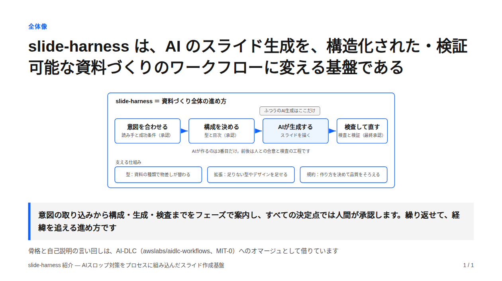

**2. 進み方は4フェーズと3つの承認ゲートで、各フェーズに成果物が残る**
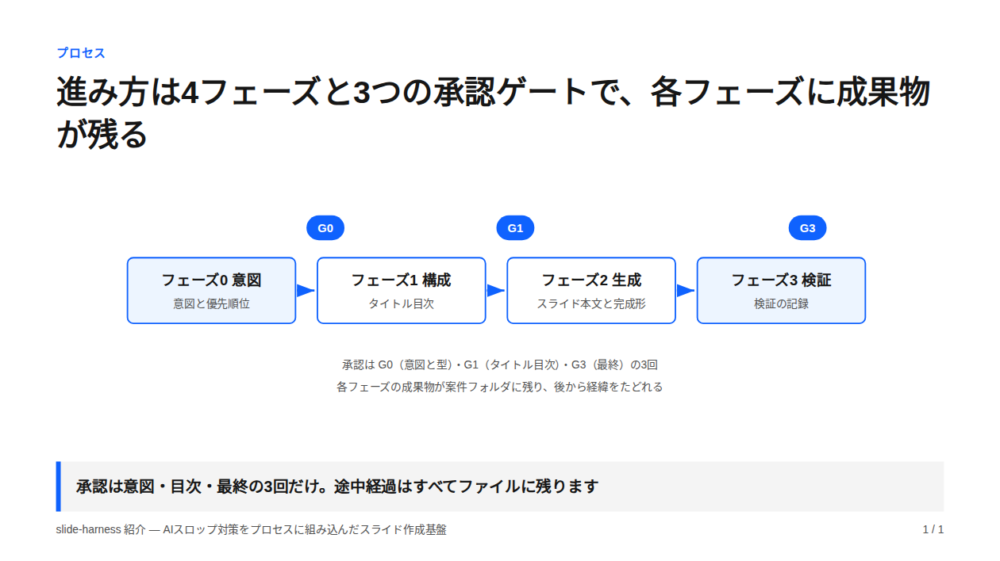

**3. AI スライドのよくある失敗は、意図合わせ・検査・直し方の工程がないことから起きる**
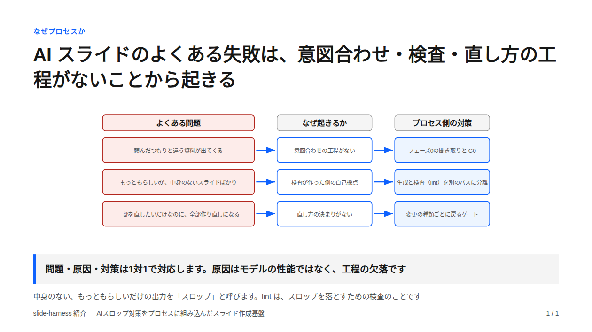

**4. 資料の型は「読み手の仕事」で決まる7つがあり、主型1つ＋副型最大1つで診断する**
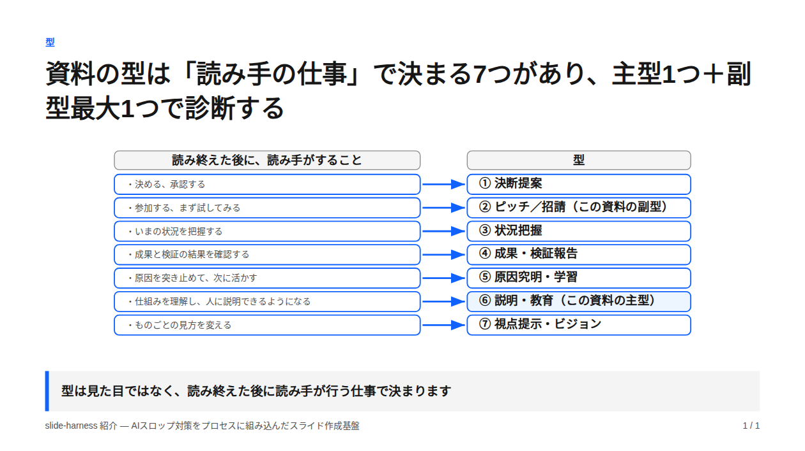

**5. 標準の仕組みは core の部品でできていて、案件ごとに作るのは内容だけだ**
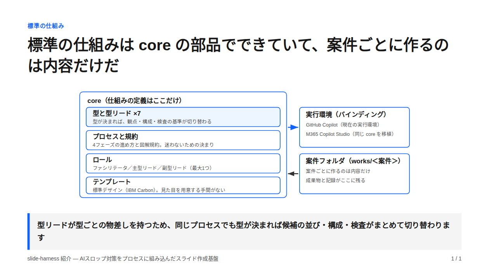

**6. 型・ロール・デザイン・規約は core を書き換えずに拡張として足し替えられる**
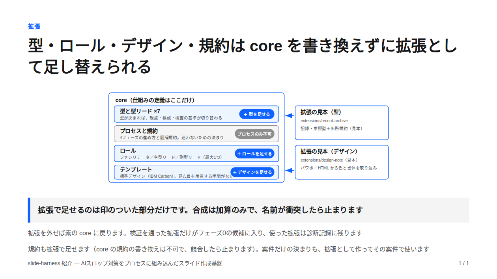

**7. 作った AI には採点させない。生成と検査を分け、検査は層ごとに違う欠陥を落とす**
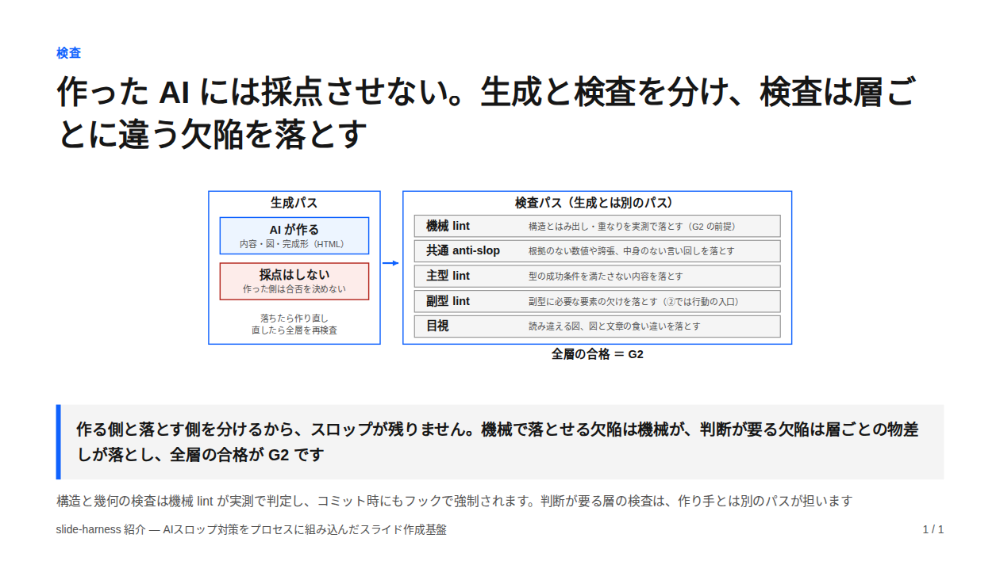

**8. 人間の指摘はパターンとして蓄積され、編集中の資料の途中から先回りで効く**
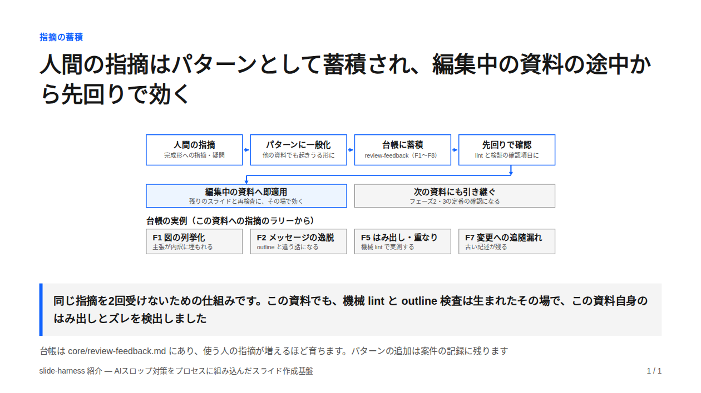

**9. 使い方は3つの操作だけ：案件フォルダを作り、意図を伝え、3回の承認に答える**
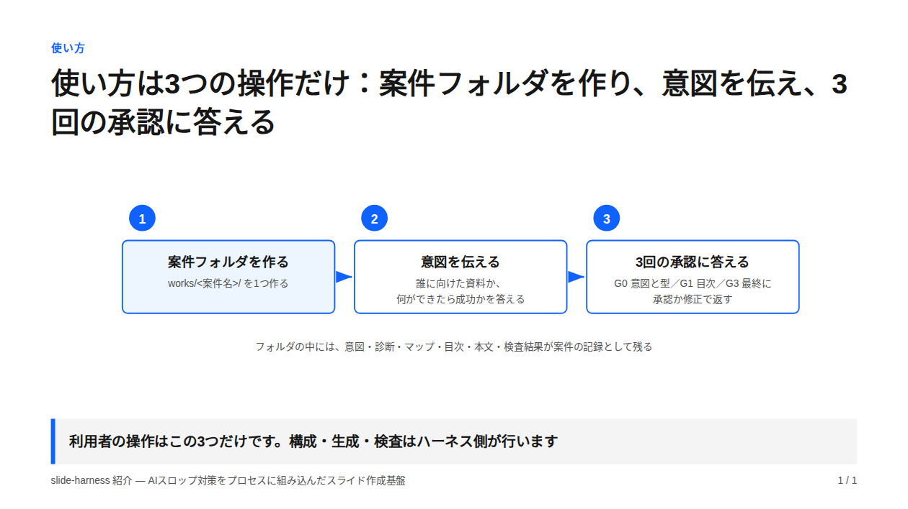

**10. 変更要求は、種類に応じて決まったゲートまで戻るだけだ**
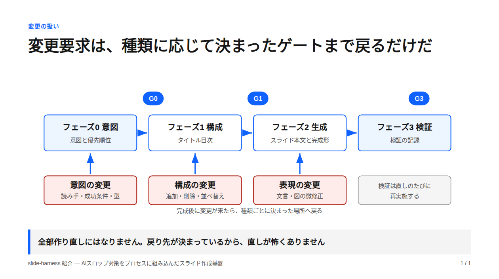

**11. 完成形は、スライドショーと編集ができる単一 HTML で出てくる**
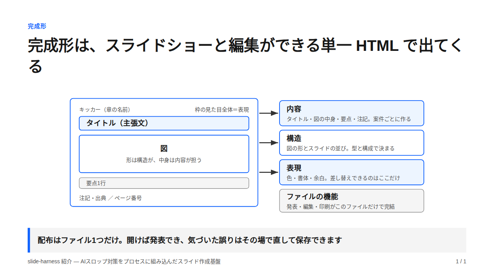

**12. まず小さい資料を1件回してみるのが入口で、試走3件では全面改訂までこのプロセスで処理した**
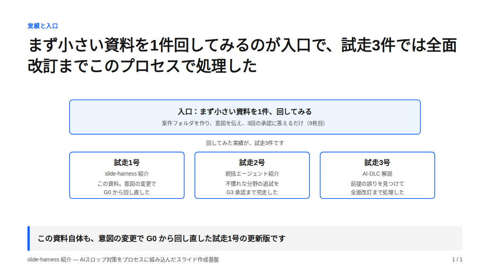

## 考え方

- **型は G0 で確定する**：資料の型（7類型、主型＋副型最大1つ）は、フェーズ0の聞き取りでエージェントが推定し、G0 の確認ラリーで擦り合わせて確定する。型がスコア基準・構成・検証の力点をすべて決める
- **圧縮は意図合わせの後**：要約やタイトル付けは、言いたいことの優先順位が人間と一致してから
- **ゲートで止まる**：承認ゲートは G0（意図・型・優先順位マップ）、G1（タイトル目次）、G3（最終）。G2 は lint の全層パスが条件で、機械 lint のパスが前提になる
- **生成と検査は別パス**：作った AI には採点させない。検査は機械 lint（構造と幾何の実測）＋内容の3層（共通 anti-slop／主型／副型）＋目視で、層ごとに違う欠陥を落とす
- **1スライド＝1メッセージ**：タイトルは主張文。図が先、文章は要点1行
- **指摘は蓄積される**：人間の指摘はパターン化して台帳（`core/review-feedback.md`）に蓄積し、編集中の資料の途中から先回りで効かせる

## 構成

```
core/                       定義の正（ここだけを直せば全体に効く）
  process.md                フェーズ・ゲート・成果物・役割
  deck-types.md             型類型（7型）の定義
  type-leads/               型リード7本のロール定義
  anti-slop-checklist.md    検査項目（共通層）
  conventions.md            規約（全層を横断する決まり）の定義と一覧
  rendering.md              完成形 HTML の作り方と視覚 lint
  extensions.md             拡張機構（型・ロール・デザイン・規約の足し方）
  review-feedback.md        指摘ナレッジ（使う人の指摘のパターン台帳）
  figure-forms.md           図の形の分類（figure-docs の要約）
.github/
  agents/slide-flow.agent.md   オーケストレータ
  agents/type-*.agent.md       型リードのエージェント定義
  copilot-instructions.md      リポジトリ全体への指示
templates/standard/         標準デザイン（IBM Carbon）
extensions/                 拡張パッケージ（見本：record-archive、design-note）
tools/
  lint-slides.py            機械 lint（構造・outline 一致・幾何の実測）
  validate-extensions.py    拡張の構造と slug 衝突の検査
  import-design.py          PowerPoint／HTML からデザインを取り込む
hooks/pre-commit            スライドを含むコミットで機械 lint を強制する
works/                      案件ごとの作業フォルダ（成果物をここに残す）
```

## 使い方

使う人の操作は3つだけです。

1. 案件フォルダ（`works/<案件名>/`）を作る
2. 意図を伝える（誰に向けた資料か、何ができたら成功か）
3. 3回の承認に答える（G0 意図と型／G1 目次／G3 最終）

セットアップ（clone したとき1回）：

```
git config core.hooksPath hooks
```

これで、スライドを含むコミットでは機械 lint が自動で走り、不合格ならコミットが止まります。
機械 lint を直接実行するには `python3 tools/lint-slides.py works/<案件名>` です（ヘッドレス Chrome を使います。パスは環境変数 `SLIDE_LINT_CHROME` で指定できます）。

## 型・ロール・デザイン・規約の追加（拡張）

新しい型・ロール・デザイン・規約は、core を書き換えずに拡張として追加します（仕組みの正は `core/extensions.md`）。
規約を足す正規の方法は、この拡張だけです。core へ直接足すこともできますが、その時点で独自の slide-harness（フォーク）になります。

1. `extensions/<名前>/` を作り、`extension.json`（manifest）に提供する型・ロール・デザイン・規約を宣言する
2. 型は `types/<slug>.md` に定義と型リードの5部品（ミッション／観点／スコア基準／典型構成と疑問チェーン／型固有 lint）を、規約は `conventions/<slug>.md` に効く層・規約・判定方法を、デザインは `designs/<slug>/template.html` にデザイン契約（CSS 変数トークン）を書く。見本は `extensions/record-archive/`（型＋規約）と `extensions/design-note/`（デザイン）
3. `python3 tools/validate-extensions.py extensions` で構造と slug の衝突を検査する。検査を通った拡張だけが、フェーズ0の候補に入る
4. status は `sample`（未検証）から始め、試走で確認して `trial` → `verified`（人間の承認）へ上げる

前提として、新しい型は「読み手の仕事」が既存の型と重ならないこと。重なる場合は新設ではなく、既存型への観点追加にします。

## デザインの差し替えと取り込み

デザイン（色・書体・余白）はテンプレートとして差し替えられます。差し替えと取り込みの対象は、この表現の層だけです。

- 解決順：案件が指定した拡張デザイン → 案件固有の `template/` → リポジトリ共有 `templates/` → 標準 `templates/standard/`
- 取り込み：`python3 tools/import-design.py --from deck.pptx|reference.html --name <拡張名> --slug <slug>` で、色と書体のトークンを抽出してデザインパッケージを作ります。ロゴ・画像・図形配置は再現しません

## 試走の実績

- 試走1号「slide-harness 紹介」（この README のスライド）：意図の変更で G0 から回し直し、G3 承認まで完走
- 試走2号「統括エージェント紹介」：不慣れな分野の追試を題材に、G3 承認まで完走
- 試走3号「AI-DLC 基本構成の解説」：前提の誤り（フェーズ数）を見つけて全面改訂まで処理

## 備考

- プロセスの正は `core/` です。エージェント定義はその参照で、矛盾したら core が優先します
- 骨格（フェーズ・ゲート・拡張）は AI-DLC（awslabs/aidlc-workflows、MIT-0）の考え方を借りています。この基盤の固有の中身は、型と型リード、anti-slop と指摘ナレッジ、図解規約、デザインの仕組みです
- M365 Copilot Studio へは、core をナレッジと指示文に写して移植する想定です
