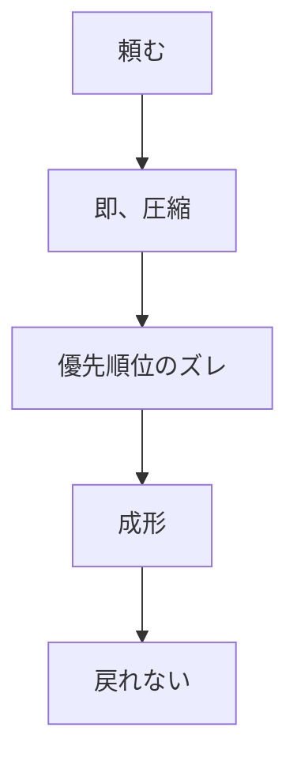
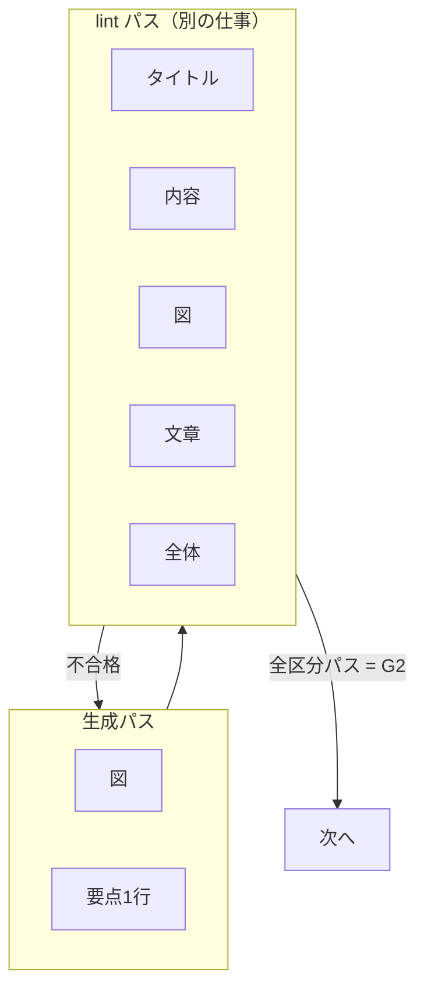

# slide-harness 紹介資料（試走1号）— スライド本体

フェーズ2の成果物（生成パス）。v2：lint ラウンド1（G2 不合格、全6枚差し戻し）の指摘を受けて生成側で修正した版。
形式は Markdown デッキ：各スライドは「タイトル（主張文）／図／要点1行／詳細（畳む）」で構成する。
図の形はスライドごとに変える（因果＝縦の連鎖、手順＝表の時間軸、対比＝2列表、比べ方＝範囲の表、役割分担＝縦レーン／対応表）。図の中の文字は部品名・値・短い注記まで。

変更メモ（lint ラウンド1への対応）：
- 全枚共通：全6枚が同じ横流れ図だった問題を、図の形の描き分けで解消した
- スライド3：タイトル中の「そのスライド」が指す対象が曖昧だったため「その資料」に直した（G1 承認タイトルからの変更。G3 で確認を受ける）
- スライド4：出典のない「2回」を削除した。コストの比べ方は色ではなく「直す範囲」の値で示した
- スライド5：図の検査項目をチェックリスト全5区分（タイトル／内容／図／文章／全体）に広げ、保証の根拠を図内に示した
- スライド6：詳細の「3点の判断だけで作られた」を実記録に合わせて直した（差し戻しの判断はゲートの中で行われた、が正確）

---

## 1. AIスライドができなかった原因は、生成能力ではなく、意図がずれたまま圧縮が始まることにある

**要点：失敗体験は本物で、付け替えるのは原因の帰属だけである。**

詳細（発表者ノート）

- 読み手の体験：それっぽいスライドが出てくるが、言いたいことの軽重が自分の考えと違い、結局自分で作り直す
- その体験を「AIはスライドができない」で片付けると、直す場所がなくなる
- 原因を「頼んだ瞬間に圧縮が始まり、優先順位のずれに気付く前に形になってしまうこと」に置くと、直す場所が1つ決まる

---

## 2. slide-harnessは、優先順位マップを承認されるまで、要約も成形も始めない

| 段階 | すること | 圧縮 |
|---|---|---|
| 拡散 | 素材を全部出す | しない |
| 順位付け | 言いたいことにスコアを付ける | しない |
| **G0** | **人間が優先順位を承認する** | **ここまでゼロ** |
| 構成以降 | 要約・成形を始める | ここから |

**要点：手綱は生成の上手さではなく、圧縮を始める位置にある。**

詳細（発表者ノート）

- フェーズ0の成果物は intent と priority-map の2ファイルだけ（core/process.md の定義どおり）
- 人間はスコアのズレを直して承認する。ズレがあれば順位付けに戻る
- この資料も、priority-map v2 が承認されるまで構成に入らなかった

---

## 3. タイトルだけ読んで話が通らなければ、その資料はまだ作る段階にない

| 名詞題の目次（例） | 主張文の目次（この資料の実タイトル） |
|---|---|
| できなかった原因 | AIスライドができなかった原因は、生成能力ではなく、意図がずれたまま圧縮が始まることにある |
| 意図合わせ | slide-harnessは、優先順位マップを承認されるまで、要約も成形も始めない |
| 検査 | 作ったAIにそのまま採点させないので、「大幅に改善」のような根拠のない一文が残らない |

**要点：構成の良し悪しは、本文を作る前にタイトルだけで試せる。**

詳細（発表者ノート）

- 対象は資料全体の目次。タイトルだけを順に読む確認をコールドリードと呼ぶ
- タイトルを文で言い切れない箇所は、中身がまだ決まっていない場所として目次に現れる
- この目次自体、承認前にタイトルだけを並べて確認した（ゲート G1）

---

## 4. 間違いは目次の段階で見つければ、直すのはその1行で済む

| 見つけた段階 | 直す範囲 |
|---|---|
| G0 優先順位 | マップの1行 |
| G1 目次 | タイトルの1行 |
| G2 lint | 該当スライドだけ |
| G3 最終・一発生成 | 全体 |

**要点：早く見つけることに価値があるのは、直すのが一番安い段階だからである。**

詳細（発表者ノート）

- 一発生成では、順番の間違い1つが全体の再生成になり、良かったスライドまで変わってしまう
- フェーズを分けると、差し戻しはその段階の成果物だけで済む。成果物はファイルで残るので、戻る先が常にある
- この資料の目次も、生成前に差し戻されて直った。直したのはタイトルと並びだけだった

---

## 5. 作ったAIにそのまま採点させないので、「大幅に改善」のような根拠のない一文が残らない

**要点：本文の質は、生成の上手さではなく別の検査で担保する。**

詳細（発表者ノート）

- 図の5区分は anti-slop チェックリストの区分そのもの（タイトル／内容／図／文章／全体）。「根拠のない一文」は内容区分の「主張に数値または出典があるか」で判定される
- 生成した同じパスが添削すると、「それっぽさ」を自分で通してしまう。lint は項目ごとにパス／不合格を判定し、不合格の理由を1行で残す
- 不合格は該当スライドだけ差し戻し、全区分パスがゲート G2

---

## 6. あなたが決めるのは最初と目次と最後の3回だけで、間の作業は全部プロセスが引き受ける

| | あなた | プロセス |
|---|---|---|
| 最初 | G0 優先順位を決める | 拡散、スコア付けの叩き台 |
| 中間 | G1 目次を決める | 構成、生成、lint、照合 |
| 最後 | G3 最終を決める | 検証メモの準備 |

**要点：全部をチェックし直すのではなく、効く3点だけを握る。**

詳細（発表者ノート）

- 人間の判断の中心は G0（優先順位）・G1（目次）・G3（最終）の3点。差し戻しの判断も、そのゲートの中で行われる
- 判断の中身はファイルに残るので、次の資料では前回の意図がそのまま出発点になる
- この資料も、判断はその3つのゲートに集約された。試す側の負担は、その判断の分だけである

